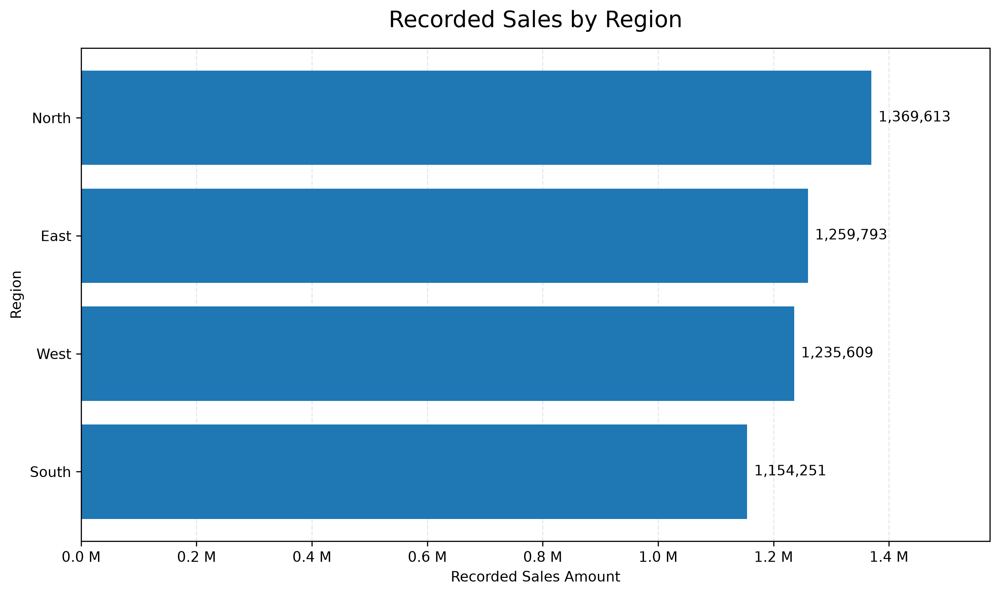
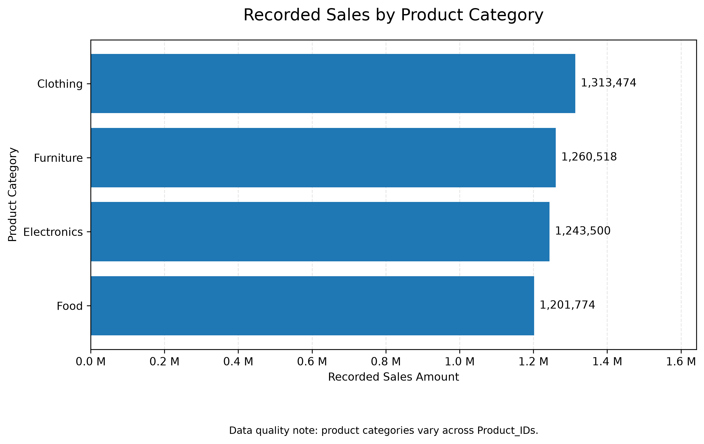
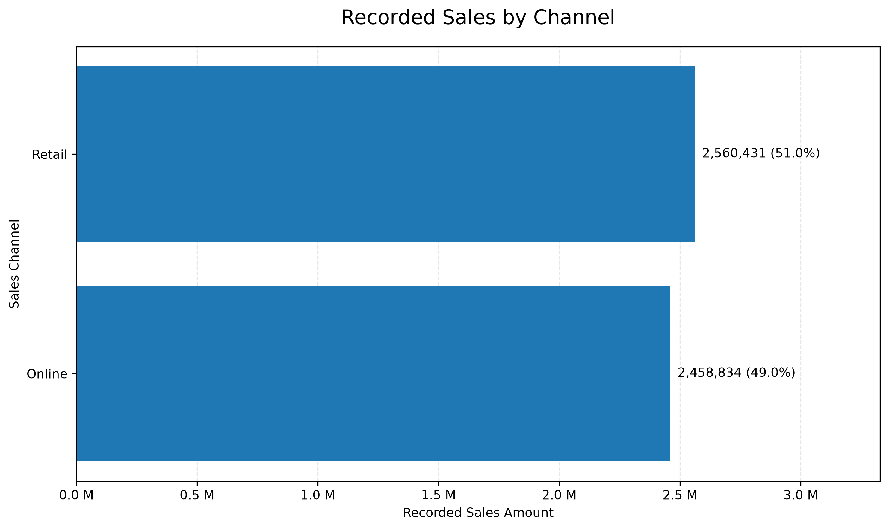
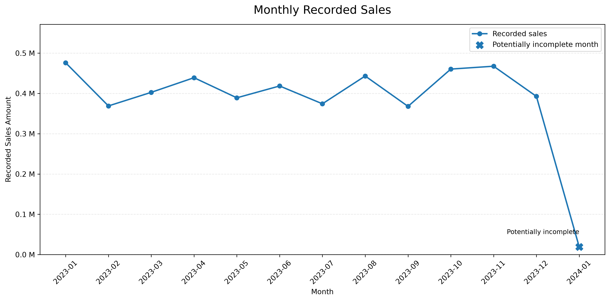

# Sales Analysis | Python Data Analytics Project

## Overview

This project explores a sales dataset containing 1,000 transactions across multiple regions, product categories, sales representatives, customer types, payment methods, and sales channels.

The objective is to transform raw sales records into actionable business insights through data exploration, performance analysis, data quality checks, and visualizations using Python.

The project also examines potential data consistency issues that may affect the interpretation of sales performance.

## Objectives

- Explore the structure and characteristics of the dataset.
- Measure overall sales performance using key performance indicators (KPIs).
- Compare recorded sales across regions, product categories, sales representatives, and sales channels.
- Examine monthly sales trends.
- Investigate potential data quality and consistency issues.
- Communicate findings through clear, reproducible visualizations.

## Tools and Technologies

- **Python**: analysis and automation
- **Pandas**: data manipulation and aggregation
- **Matplotlib**: data visualization
- **Pathlib**: file and directory management
- **Git and GitHub**: version control and project sharing

## Project Structure

```text
Sales Analysis/
├── data/
│   └── sales_data.csv
├── scripts/
│   ├── 1_data_exploration.py
│   ├── 2_sales_analysis.py
│   └── 3_visualization.py
├── outputs/
│   ├── figures/
│   │   ├── sales_by_region.png
│   │   ├── monthly_sales_trend.png
│   │   ├── sales_by_category.png
│   │   └── sales_by_channel.png
│   └── tables/
│       └── data_quality_report.csv
├── sql/
├── .gitignore
└── README.md
```

### Directory guide

| Component | Purpose |
|---|---|
| `data/` | Stores the source sales dataset. |
| `scripts/1_data_exploration.py` | Examines dataset structure, data types, and initial characteristics. |
| `scripts/2_sales_analysis.py` | Calculates business KPIs, aggregates sales, and investigates data consistency. |
| `scripts/3_visualization.py` | Generates and exports sales visualizations. |
| `outputs/figures/` | Contains exported charts in PNG format. |
| `outputs/tables/` | Stores the data quality report. |
| `sql/` | Reserved for potential SQL exercises or extensions. |

## Dataset Description

The dataset contains **1,000 rows and 14 columns**, representing sales transactions.

Key fields include:

- `Product_ID`: product identifier
- `Sale_Date`: transaction date
- `Sales_Rep`: sales representative
- `Region`: sales region
- `Sales_Amount`: recorded transaction amount
- `Quantity_Sold`: quantity recorded as sold
- `Product_Category`: product category
- `Unit_Cost` and `Unit_Price`: recorded unit cost and price
- `Customer_Type`: customer classification
- `Discount`: recorded discount
- `Payment_Method`: payment method
- `Sales_Channel`: sales channel
- `Region_and_Sales_Rep`: combined region and representative field

The observed transaction dates range from January 1, 2023, to January 1, 2024.

## Data Source and License

The dataset used in this project is publicly available on Kaggle.

- **Dataset:** [Sales Dataset](https://www.kaggle.com/datasets/vinothkannaece/sales-dataset)
- **Dataset author:** [vinothkannaece](https://www.kaggle.com/vinothkannaece)
- **Platform:** Kaggle
- **License:** [CC0 1.0 Universal](https://creativecommons.org/publicdomain/zero/1.0/)

The dataset is used in this individual portfolio project for exploratory data analysis, sales performance analysis, data quality assessment, and visualization.

The analysis and visualizations presented in this repository are my own work, based on the source dataset. This attribution does not imply endorsement by the dataset author.

## Key Findings

### 1. Overall Performance

| Metric | Result |
|---|---:|
| Total recorded sales | 5,019,265.23 |
| Number of transactions | 1,000 |
| Total units recorded | 25,355 |
| Average recorded transaction value | 5,019.27 |
| Distinct product IDs | 100 |
| Sales representatives | 5 |
| Regions | 4 |

*Note: The monetary unit is not specified in the source dataset. These figures represent recorded values, not independently verified revenue.*

### 2. Sales by Region

| Region | Recorded Sales | Share |
|---|---:|---:|
| North | 1,369,612.51 | 27.29% |
| East | 1,259,792.93 | 25.10% |
| West | 1,235,608.93 | 24.62% |
| South | 1,154,250.86 | 23.00% |

North records the highest sales amount, while South records the lowest. The distribution is relatively balanced across the four regions.



### 3. Sales by Product Category

Clothing records the highest sales amount, followed by Furniture, Electronics, and Food.

The differences between categories are relatively modest, suggesting that recorded sales are distributed across several product categories rather than being dominated by a single category.



### 4. Sales by Channel

| Channel | Recorded Sales | Share |
|---|---:|---:|
| Retail | 2,560,431.30 | 51.01% |
| Online | 2,458,833.93 | 48.99% |

Retail represents a slight majority of recorded sales, with online sales accounting for nearly half of the total.



### 5. Monthly Sales Trend

Monthly recorded sales fluctuate throughout 2023. January 2024 contains only three transactions and is flagged as potentially incomplete.

This observation warrants further investigation before drawing conclusions about January performance. The available data alone does not establish whether the month is incomplete.



## Data Quality and Consistency Checks

Beyond descriptive analysis, this project investigates several characteristics that could affect interpretation.

### Sales amount consistency

The recorded `Sales_Amount` values were compared with candidate calculations based on `Unit_Price`, `Quantity_Sold`, and `Discount`.

The candidate calculations differ substantially from the recorded amounts. For example, the candidate formula incorporating price, quantity, and discount produces a mean absolute deviation of approximately **55,027.78**.

These differences do not, by themselves, prove that the recorded amounts are incorrect. The dataset does not provide a confirmed business formula explaining how `Sales_Amount` was calculated.

### Product attribute consistency

All 100 distinct `Product_ID` values exhibit variation in recorded unit prices, unit costs, and product categories.

This pattern should be investigated before treating `Product_ID` as a stable product catalog identifier. It may reflect data quality issues, changes over time, or an undocumented meaning of the identifier.

### Additional checks

The analysis also examines:

- Missing values and duplicate records.
- Discount boundaries.
- Cases where recorded unit cost exceeds recorded unit price.
- Category, region, channel, and representative distributions.
- Date coverage and transaction counts.

The detailed results are available in `outputs/tables/data_quality_report.csv`.

## Running the Project

### Prerequisites

Install Python and the required libraries:

```bash
python -m pip install pandas matplotlib
```

### Run the exploration

From the project root:

```bash
python scripts/1_data_exploration.py
```

### Run the sales analysis

```bash
python scripts/2_sales_analysis.py
```

### Generate the visualizations

```bash
python scripts/3_visualization.py
```

The visualization script reads `data/sales_data.csv` and exports the charts to `outputs/figures/`.

Run each script from the project root so that the relative project paths resolve correctly.

## Limitations

- The source dataset does not specify a currency.
- The business definition of `Sales_Amount` is not documented.
- The relationship between `Product_ID` and product attributes requires clarification.
- January 2024 contains very few transactions and may not be comparable with previous months.
- Descriptive patterns do not establish causation or explain the underlying business drivers.

These limitations are documented to avoid overstating the findings and to identify areas for further investigation.

## Future Improvements

- Clarify the business rules behind recorded sales amounts.
- Investigate product identifier consistency.
- Add automated data validation tests.
- Extend the analysis with additional business questions once the data definitions are confirmed.
- Introduce SQL-based analysis where it adds value.
- Improve the reporting workflow and make the project easier to reproduce.

## Skills Demonstrated

- Data loading and preprocessing
- Exploratory data analysis (EDA)
- KPI calculation and aggregation
- Data quality assessment
- Business-oriented data interpretation
- Data visualization with Matplotlib
- Python scripting and project organization
- Reproducible analysis and version control

## Conclusion

This project demonstrates an end-to-end exploratory sales analytics workflow, from inspecting raw transaction data to producing business-oriented summaries and visual reports.

A key outcome is the identification of potential consistency issues that require clarification before the dataset can confidently support financial conclusions.

The project emphasizes not only generating insights, but also evaluating the reliability of the data behind them.

## Author

**Alan Ngang a.k.a Chronos**  
Aspiring Data Analyst | Python Developer

This is an individual portfolio project developed to practice Python-based data analysis, data quality assessment, business insight generation, and data visualization.

Contributions:

-Dataset exploration and preprocessing
-Sales performance analysis and KPI calculation
-Data quality and consistency checks
-Data visualization using Matplotlib
-Project documentation and organization

- **GitHub:** [@chrono-byte238](https://github.com/chrono-byte238)
- **LinkedIn:** [@Alan Ngang](<https://www.linkedin.com/in/alan-ngang-5295a338a>)

I welcome feedback, suggestions, and opportunities to collaborate on data-driven projects.